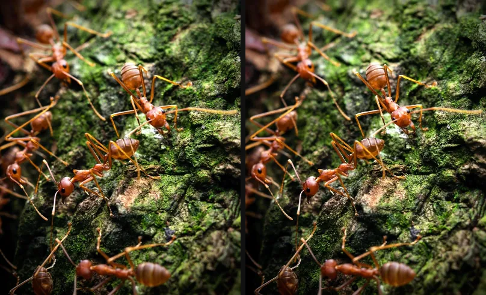

# SHARP on AX8860

Single image → 3D Gaussian Splatting **on the AX8860 NPU in ~1.6 s**.
A port of Apple's [SHARP](https://github.com/apple/ml-sharp) ("Sharp Monocular View Synthesis in Less Than a Second") to the AXERA AX8860.

单张照片 → 3D 高斯（3DGS），**AX8860 端侧约 1.6 秒**。本项目把 Apple 的 [SHARP](https://github.com/apple/ml-sharp) 移植到 AXERA AX8860 NPU。

<p align="center"></p>
<p align="center"><sub>Left: input photo · Right: 3D Gaussians generated on the AX8860 board, rendered from new viewpoints<br>左：输入照片 · 右：AX8860 板上生成的 3D 高斯，换视角渲染</sub></p>

## Highlights / 亮点

- **~1.6 s end-to-end on the board** (JPEG decode + inference + post-process + writing the result), models loaded once.
- **Close to the FP32 GPU reference**: renderings of the board output vs. the official FP32 model on GPU from 4 shifted viewpoints, median PSNR **41.9 dB** on 29 COCO photos and **33.9 dB** on 50 DIV2K photos (none of them used for calibration). The lowest scores come from thin high-contrast structures (e.g. star trails) where a sub-pixel shift already costs a lot of PSNR; they look the same side by side.
- **1.18 M Gaussians per image**, written as **SPZ (12–17 MB)** or the original PLY layout of ml-sharp (66 MB).
- C++ command line tool, a C shared library and a Python binding with a browser demo that runs on the board.

| Stage / 阶段 | Time (ms) | Where |
|---|---:|---|
| JPEG decode (hardware JDEC) | 20–60 | VDEC |
| Pre-process (resize, image pyramid, 36 crops) | ~70 | CPU |
| ViT ×36 (DINOv2-L, FP8) | ~760 | NPU |
| Tail (DPT + Gaussian decoder, U16) | ~490 | NPU |
| Depth head last layer (FP32) | ~50 | CPU |
| Post-process (Gaussians, unprojection) | ~160 | CPU |
| Write SPZ / PLY | ~170 / ~65 | CPU |
| **End-to-end** | **~1600–1700** | |

<sub>AX8860, 4 NPU cores, 16× Cortex-A55, SDK V0.6.0. Model loading (once): ~0.8 s.</sub>

## Quick start / 快速开始

### 1. Models / 模型

Download from Hugging Face: [AXERA-TECH/sharp-ax8860](https://huggingface.co/AXERA-TECH/sharp-ax8860)

```
models/
├── fp8vit/                 # DINOv2-L ViT, FP8 kernels + weight banks (patch / image encoder)
├── sharp_tail.axmodel      # DPT decoder + Gaussian decoder (U16)
└── h4_wb.bin               # last 1x1 conv of the depth head, run on the CPU in FP32
```

### 2. Command line / 命令行

```bash
./sharp_ax -m models -i photo.jpg -o photo.spz      # .spz = SPZ v2 (~1/4 size), .ply = ml-sharp PLY
```

```
load 830 ms
decode 59 ms (JDEC)
image 3072x4096 f_px=3550.08
preprocess 62 ms
vit x36 742 ms
tail 490 ms
  h4 (CPU FP32) 53 ms
postprocess 161 ms
write 163 ms -> photo.spz (1179648 gaussians)
end-to-end 1678 ms (decode + inference + post-process + write, excluding model loading)
```

Options: `--f35 MM` 35 mm-equivalent focal length (default 30, as ml-sharp does without EXIF), `--fpx PX` focal length in pixels, `-t N` threads, `--dump DIR` intermediate tensors. `SHARP_PROF=1` prints per-stage details.

### 3. Python / Web demo

```bash
cd python
cp ../build/libsharp_ax.so .
python3 -c "from sharp_ax import Sharp; s = Sharp('../models'); print(s.run('photo.jpg', 'photo.spz'))"

python3 web_demo.py -m ../models --port 8080          # open http://<board-ip>:8080
```

`sharp_ax.py` only needs the Python standard library (ctypes). The web demo uploads a photo from the browser (rotated by EXIF, resized and re-encoded as JPEG in the browser), runs it on the NPU and shows the result with [GaussianSplats3D](https://github.com/mkkellogg/GaussianSplats3D). Results can be downloaded as `.spz` and opened in other viewers such as [SuperSplat](https://superspl.at/editor).

C API (`src/sharp_ax.h`):

```c
sharp_ctx* sharp_create(const char* model_dir, int threads);
int  sharp_run(sharp_ctx*, const unsigned char* image, size_t len, const char* out_path /* .spz or .ply */,
               double f35, double fpx, sharp_timing* timing);
void sharp_destroy(sharp_ctx*);
const char* sharp_last_error(void);
```

## Build / 编译

Cross-compile with the Arm GNU Toolchain 13.2 (aarch64-none-linux-gnu, glibc ≥ 2.38) and the AX8860 BSP (`include/` + `lib/` with `ax_engine`, `ax_sys`, `ax_vdec`):

```bash
cmake -B build -DCMAKE_TOOLCHAIN_FILE=cmake/aarch64-none-linux-gnu.cmake \
      -DTOOLCHAIN_DIR=/path/to/arm-gnu-toolchain-13.2.Rel1-x86_64-aarch64-none-linux-gnu \
      -DBSP_DIR=/path/to/ax8860_bsp/arm64_glibc
cmake --build build -j        # -> build/sharp_ax, build/libsharp_ax.so
```

A host build that only runs the CPU post-process on dumped tensors (for checking against PyTorch): `cmake -B build-host -DSHARP_POST_ONLY=ON`.

### Model conversion / 模型转换

[`tools/convert/`](tools/convert/) rebuilds `sharp_tail.axmodel` and `h4_wb.bin` from Apple's checkpoint (ONNX export with the 768² rewrite, tensor splitting, CPU depth-head layer, multi-photo calibration, pulsar2 U16 config). The FP8 ViT is provided prebuilt only.

## How it works / 实现要点

| | ml-sharp (GPU) | This port (AX8860) |
|---|---|---|
| ViT (36 × DINOv2-L, 577 tokens) | FP32 | FP8 kernels, weights stay in CMM, zero-copy binding |
| Decoders (DPT + Gaussian decoder) | FP32 | pulsar2 U16, calibrated on 80 diverse photos |
| Last 1×1 conv of the depth head | FP32 | CPU FP32 (INT8 weights cost ~10 dB on novel views) |
| Post-process | PyTorch | C++, multi-threaded + NEON |
| Output | PLY 66 MB | SPZ 12–17 MB (or PLY) |

- 16-bit tensors larger than 128 MiB are split along channels before compilation, the NPU does not handle such tensors.
- The depth head's last 1×1 convolution is computed on the CPU in FP32: novel-view quality depends almost entirely on disparity precision, and INT8 weights there cost ~10 dB.
- SPZ writer: positions as 24-bit fixed point, other attributes 8-bit, tile-wise Morton order, parallel deflate into one gzip stream. Rendering vs. the full-precision PLY: 47–52 dB.

## License / 许可

- Code in this repository: [BSD 3-Clause](LICENSE).
- Model weights are derived from Apple's SHARP checkpoint and are released under the **Apple Machine Learning Research Model License** ([LICENSE_MODEL](LICENSE_MODEL)), **for non-commercial research purposes only**. *Apple Machine Learning Research Model is licensed under the Apple Machine Learning Research Model License Agreement.* The weights here are model derivatives (quantized to FP8/U16, split into ViT and decoder graphs, last depth-head layer kept in FP32); see the model card on Hugging Face for the full list of changes.
- This project is not affiliated with or endorsed by Apple.
- `third_party/stb_image.h`: public domain / MIT ([stb](https://github.com/nothings/stb)).

## Acknowledgements

[apple/ml-sharp](https://github.com/apple/ml-sharp) · [GaussianSplats3D](https://github.com/mkkellogg/GaussianSplats3D) · [SPZ](https://github.com/nianticlabs/spz) · [stb](https://github.com/nothings/stb). Demo photo: [Pexels](https://www.pexels.com) (Niko Desmon).
